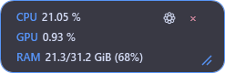
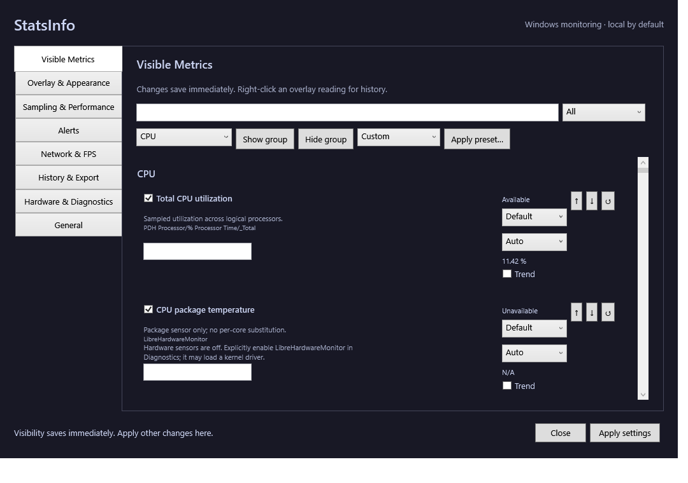

# StatsInfo

A small Windows performance overlay that keeps the readings you care about visible while you work, play, or troubleshoot your PC.

StatsInfo was built to answer everyday questions such as "Is my CPU busy?", "How much memory am I using?", and "Is something downloading?" without repeatedly opening a full monitoring dashboard. Choose your metrics, move the overlay out of the way, and leave it on top of your other windows.

## Download and install

**[Download the latest Windows installer](https://github.com/gopichandchikoti/StatsInfo/releases/latest/download/StatsInfo-Setup.exe)**

[Portable Windows download](https://github.com/gopichandchikoti/StatsInfo/releases/latest/download/StatsInfo-Portable-win-x64.zip) · [All releases](https://github.com/gopichandchikoti/StatsInfo/releases)

Requires **64-bit Windows 10 or Windows 11**. The installer includes the .NET runtime. Download `StatsInfo-Setup.exe`, run the setup wizard, then open StatsInfo from the Start Menu. For portable use, extract the ZIP and run `StatsInfo.exe` from the extracted folder. StatsInfo is a Windows desktop application; an Android APK is not provided.

To upgrade, exit the running overlay from its close button or tray menu, then run the latest installer. Preferences are retained. To uninstall, use Windows **Settings → Apps → Installed apps**.

## What it does

- Shows CPU and GPU usage, memory, network download/upload rates, display refresh rate, uptime, and other selected readings in an always-on-top overlay.
- Offers 70 selectable metric entries across CPU, GPU, memory, storage, network, display, battery, system, and processes. Availability depends on Windows, your hardware, and enabled sources; unavailable readings explain why.
- Lets you search, reorder, rename, and format metrics, choose presets, and customize colors, fonts, opacity, and scale.
- Resizes from the **bottom-right corner**. Narrow layouts stack metrics vertically; wide layouts put them side by side. The minimum size follows the selected metrics, so a CPU-only overlay can be much smaller. Size is remembered between launches.
- Provides recent history, optional sparklines, CSV/JSON export, and configurable sustained threshold alerts.
- Keeps collection local. Hardware sensors, network latency probes, saved history, and optional PresentMon frame capture require explicit opt-in.

Display refresh rate is the monitor's configured Hz, not game FPS. Game FPS requires a compatible, user-supplied PresentMon console executable and an explicitly started capture. Some advanced sensor metrics remain unavailable on unsupported devices; see [architecture and source limitations](docs/architecture.md#metric-sources-and-limitations).

## Screenshots

These captures come from the packaged Windows app. Readings and available sensors vary by PC.

**Wide overlay**


**Narrow overlay and CPU-only minimum**




**Settings**



## Everyday controls

Click **⚙** to open Settings. Metric visibility saves immediately; use **Apply settings** for appearance and sampling changes. Drag a metric area to move the overlay, and drag the bottom-right grip to resize it. A layout choice supplies a starting size; selecting a different layout resets the saved dimensions.

Right-click a metric to view its history. The tray menu can show or hide the overlay, pause monitoring, open Settings, or exit. Defaults: **Ctrl+Shift+F11** shows/hides the overlay; **Ctrl+Shift+F10** recovers its position and disables click-through. Hotkey conflicts are reported in Settings.

Settings are stored in `%APPDATA%\StatsInfo\settings.json`. The app preserves existing preferences when upgrading. When many metrics cannot fit within the selected monitor's work area, scrolling keeps them reachable.

## Build and run from source

Install the .NET 8 SDK on Windows, then run from the repository root:

```powershell
dotnet restore StatsInfo.sln
dotnet build StatsInfo.sln -c Release
dotnet run --project src/StatsInfo
```

To build and launch with Settings open, including support for a locally installed SDK:

```powershell
powershell -ExecutionPolicy Bypass -File tools/run-local.ps1
```

Add `-ProfilePath artifacts/qa/my-profile/settings.json` for isolated preferences, or `-OverlayOnly` to launch just the overlay. No web server or localhost port is needed.

## Tests and releases

```powershell
dotnet test StatsInfo.sln -c Release /p:CollectCoverage=true /p:CoverletOutputFormat=cobertura /p:Threshold=90 /p:ThresholdType=line /p:ThresholdStat=total
```

CI runs the tests and requires at least 90% line coverage. Version tags such as `v2.1.0` build a self-contained Windows app and Inno Setup installer. Before publishing downloads, the release workflow launches the packaged executable with isolated settings, checks Settings open/reopen and responsive sizing, and keeps screenshots and a verification receipt as workflow artifacts. Pushing source changes alone does not replace an existing release download.

Build details, data flow, source coverage, configuration, and release verification are documented in [docs/architecture.md](docs/architecture.md). Third-party license information is in [THIRD_PARTY_NOTICES.md](THIRD_PARTY_NOTICES.md).
